<div align="center">

<br>

<a href="https://motionshelf-pi.vercel.app">
  <picture>
    <source media="(prefers-color-scheme: dark)" srcset=".github/readme/logo-dark.png">
    <source media="(prefers-color-scheme: light)" srcset=".github/readme/logo-light.png">
    
  </picture>
</a>

<br><br>

**Motion your clients will ask for.**<br>
Animated React components for sites that sell, installed as code you own.

<a href="https://motionshelf-pi.vercel.app"></a>      <a href="LICENSE"></a>

[Website](https://motionshelf-pi.vercel.app) · [Components](https://motionshelf-pi.vercel.app/components) · [Installation](https://motionshelf-pi.vercel.app/docs/installation) · [Make it with your agent](https://motionshelf-pi.vercel.app/docs/agents)

</div>

---

Payment notifications, chat flows, map pins, search results, booking slots, and isometric machines that explain a sales idea. Every component has a live preview, its source, its props, a one-line install, and a **prompt that teaches your AI agent to rebuild it** in your own project. English and Portuguese.

## Components

<table>
  <tr>
    <td width="33%" align="center" valign="top">
      <a href="https://motionshelf-pi.vercel.app/components/payment-notification">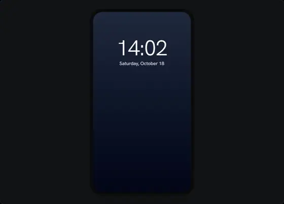</a><br>
      <b>Payment Notification</b><br><sub>Commerce</sub>
    </td>
    <td width="33%" align="center" valign="top">
      <a href="https://motionshelf-pi.vercel.app/components/chat-flow">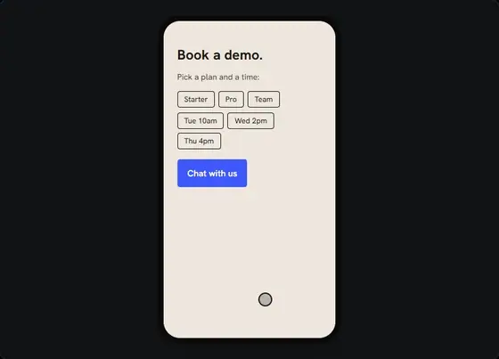</a><br>
      <b>Chat Flow</b><br><sub>Messages</sub>
    </td>
    <td width="33%" align="center" valign="top">
      <a href="https://motionshelf-pi.vercel.app/components/map-pin-drop">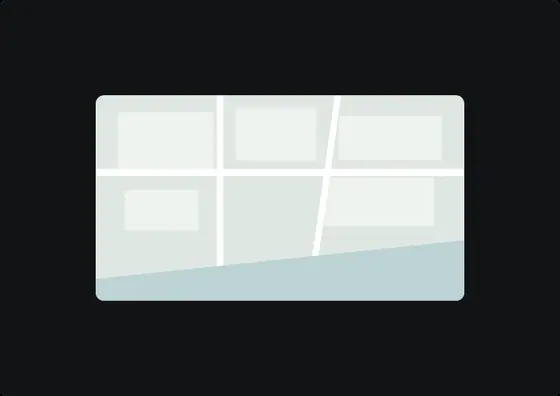</a><br>
      <b>Map Pin Drop</b><br><sub>Location</sub>
    </td>
  </tr>
  <tr>
    <td width="33%" align="center" valign="top">
      <a href="https://motionshelf-pi.vercel.app/components/title-reveal">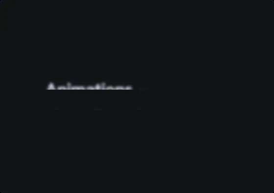</a><br>
      <b>Title Reveal</b><br><sub>Text</sub>
    </td>
    <td width="33%" align="center" valign="top">
      <a href="https://motionshelf-pi.vercel.app/components/rotating-word">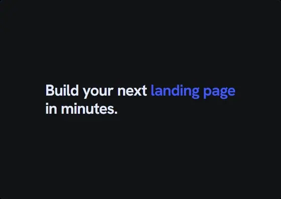</a><br>
      <b>Rotating Word</b><br><sub>Text</sub>
    </td>
    <td width="33%" align="center" valign="top">
      <a href="https://motionshelf-pi.vercel.app/components/before-after-text">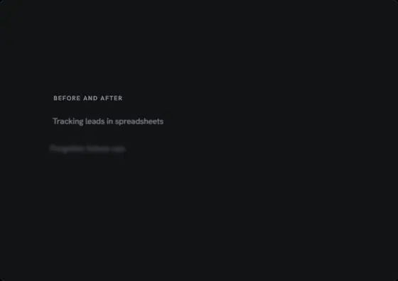</a><br>
      <b>Before and After Text</b><br><sub>Text</sub>
    </td>
  </tr>
  <tr>
    <td width="33%" align="center" valign="top">
      <a href="https://motionshelf-pi.vercel.app/components/question-typer">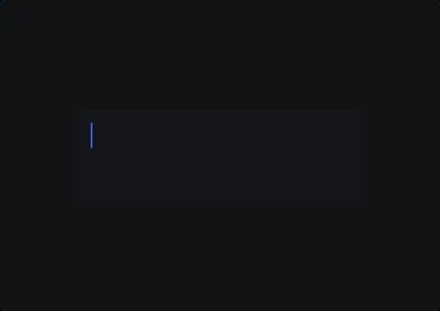</a><br>
      <b>Question Typer</b><br><sub>Messages</sub>
    </td>
    <td width="33%" align="center" valign="top">
      <a href="https://motionshelf-pi.vercel.app/components/appointment-reminder">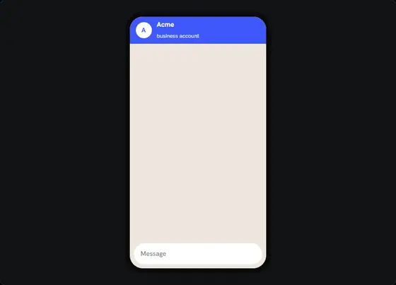</a><br>
      <b>Appointment Reminder</b><br><sub>Messages</sub>
    </td>
    <td width="33%" align="center" valign="top">
      <a href="https://motionshelf-pi.vercel.app/components/search-ad">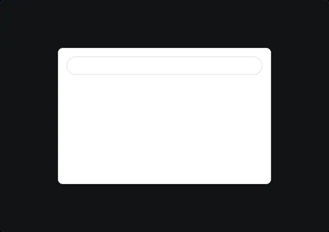</a><br>
      <b>Search Ad</b><br><sub>Commerce</sub>
    </td>
  </tr>
  <tr>
    <td width="33%" align="center" valign="top">
      <a href="https://motionshelf-pi.vercel.app/components/slot-booking">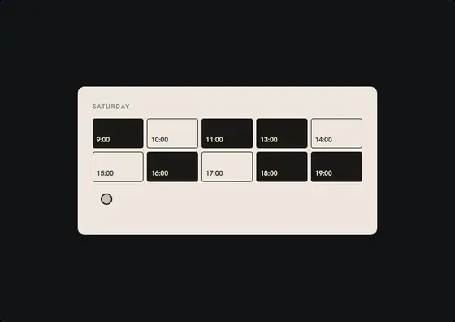</a><br>
      <b>Slot Booking</b><br><sub>Scheduling</sub>
    </td>
    <td width="33%" align="center" valign="top">
      <a href="https://motionshelf-pi.vercel.app/components/sales-funnel">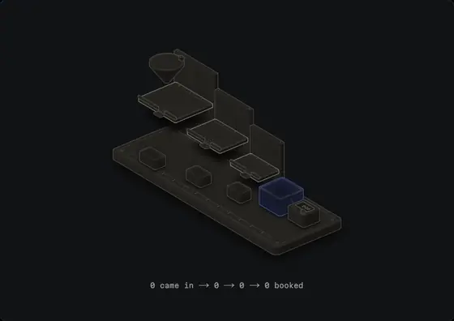</a><br>
      <b>Sales Funnel</b><br><sub>Anatomy</sub>
    </td>
    <td width="33%" align="center" valign="top">
      <a href="https://motionshelf-pi.vercel.app/components/roi-balance">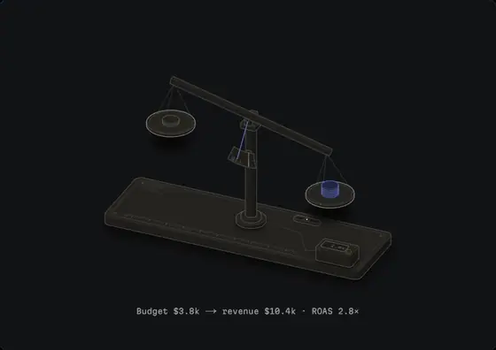</a><br>
      <b>ROI Balance</b><br><sub>Anatomy</sub>
    </td>
  </tr>
  <tr>
    <td width="33%" align="center" valign="top">
      <a href="https://motionshelf-pi.vercel.app/components/page-speed-gauge">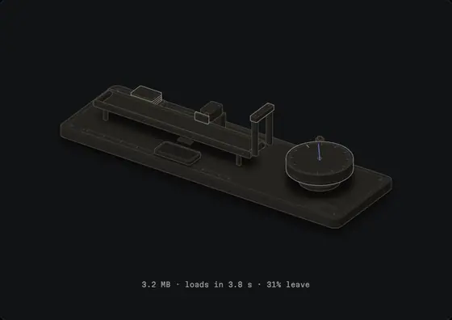</a><br>
      <b>Page Speed Gauge</b><br><sub>Anatomy</sub>
    </td>
    <td width="33%" align="center" valign="top">
      <a href="https://motionshelf-pi.vercel.app/components/add-to-cart">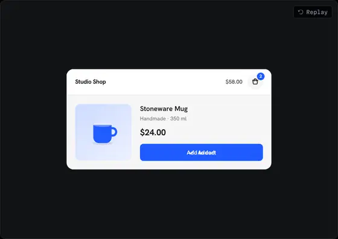</a><br>
      <b>Add to Cart</b><br><sub>Commerce</sub>
    </td>
    <td width="33%" align="center" valign="top">
      <a href="https://motionshelf-pi.vercel.app/components/plan-toggle">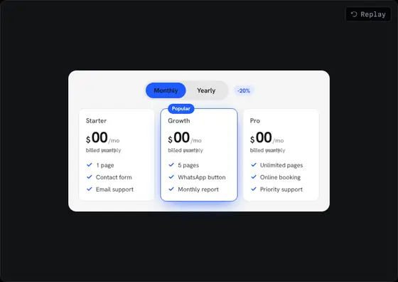</a><br>
      <b>Plan Toggle</b><br><sub>Commerce</sub>
    </td>
  </tr>
  <tr>
    <td width="33%" align="center" valign="top">
      <a href="https://motionshelf-pi.vercel.app/components/offer-countdown">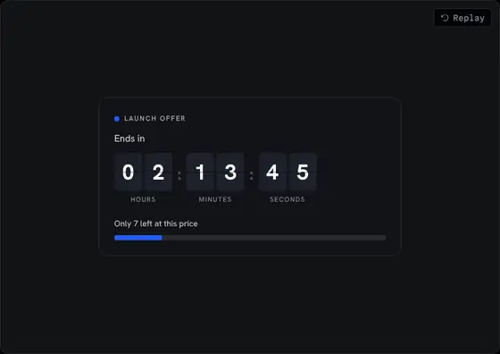</a><br>
      <b>Offer Countdown</b><br><sub>Commerce</sub>
    </td>
    <td width="33%" align="center" valign="top">
      <a href="https://motionshelf-pi.vercel.app/components/review-card">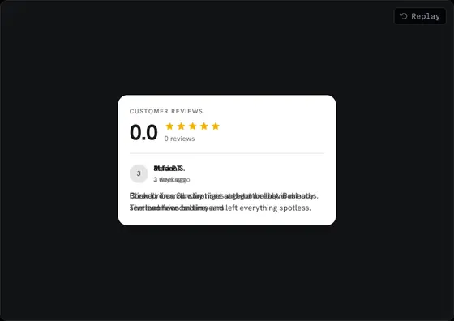</a><br>
      <b>Review Card</b><br><sub>Social proof</sub>
    </td>
    <td width="33%" align="center" valign="top">
      <a href="https://motionshelf-pi.vercel.app/components/order-tracker">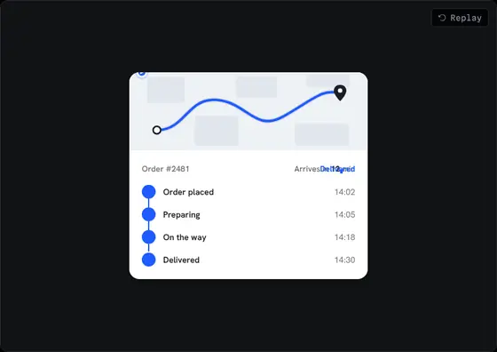</a><br>
      <b>Order Tracker</b><br><sub>Location</sub>
    </td>
  </tr>
  <tr>
    <td width="33%" align="center" valign="top">
      <a href="https://motionshelf-pi.vercel.app/components/drone-button">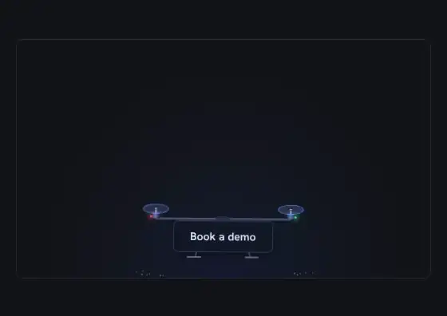</a><br>
      <b>Drone Button</b><br><sub>Buttons</sub>
    </td>
    <td width="33%" align="center" valign="top">
      <a href="https://motionshelf-pi.vercel.app/components/claw-button">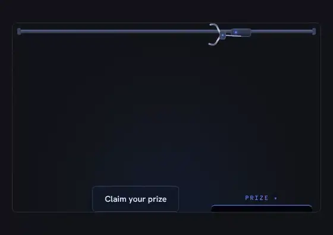</a><br>
      <b>Claw Machine</b><br><sub>Buttons</sub>
    </td>
    <td width="33%" align="center" valign="top">
      <a href="https://motionshelf-pi.vercel.app/components/rocket-button">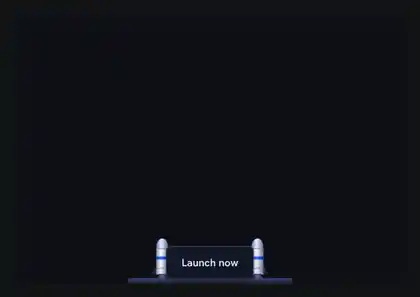</a><br>
      <b>Rocket Launch</b><br><sub>Buttons</sub>
    </td>
  </tr>
  <tr>
    <td width="33%" align="center" valign="top">
      <a href="https://motionshelf-pi.vercel.app/components/ufo-button">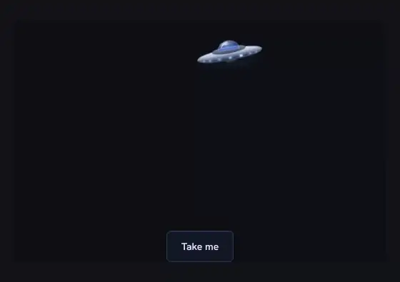</a><br>
      <b>UFO Abduction</b><br><sub>Buttons</sub>
    </td>
    <td width="33%" align="center" valign="top">
      <a href="https://motionshelf-pi.vercel.app/components/magnet-button">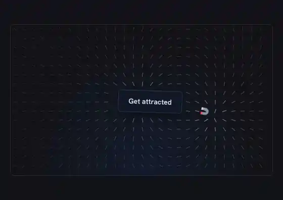</a><br>
      <b>Magnet</b><br><sub>Buttons</sub>
    </td>
    <td width="33%" align="center" valign="top">
      <a href="https://motionshelf-pi.vercel.app/components/letters-button">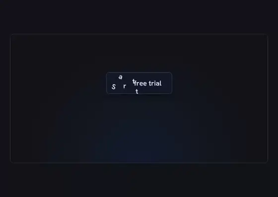</a><br>
      <b>Falling Letters</b><br><sub>Buttons</sub>
    </td>
  </tr>
  <tr>
    <td width="33%" align="center" valign="top">
      <a href="https://motionshelf-pi.vercel.app/components/bulb-toggle">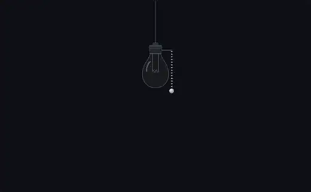</a><br>
      <b>Light Bulb</b><br><sub>Toggles</sub>
    </td>
    <td width="33%" align="center" valign="top">
      <a href="https://motionshelf-pi.vercel.app/components/hourglass-loader">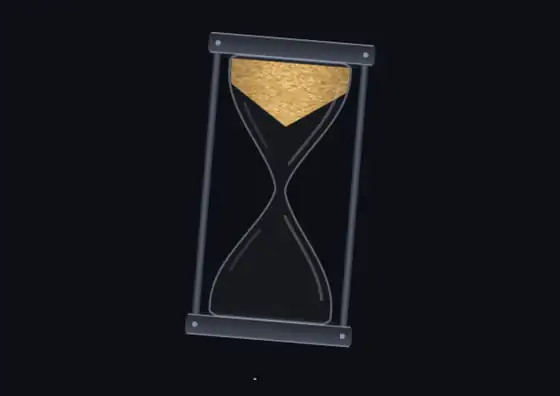</a><br>
      <b>Hourglass</b><br><sub>Loaders</sub>
    </td>
    <td width="33%" align="center" valign="top">
      <a href="https://motionshelf-pi.vercel.app/components/origami-button">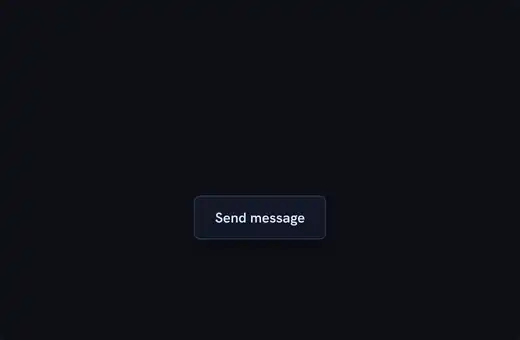</a><br>
      <b>Origami</b><br><sub>Buttons</sub>
    </td>
  </tr>
</table>

The three **Anatomy** components are interactive isometric figures: move the pointer over them and the model behind them changes (ad budget, page weight), and the readout under the figure updates from the same numbers.

The seven **Buttons** are real buttons with a small physics world around them: a drone that flies the button to the cursor, an arcade claw that grabs it, a rocket that launches it, a flying saucer that beams it up, a magnet that pulls it while iron filings trace the field, letters that fall out and pile up, and a sheet of paper that folds into a plane, loops the loop and lands back as the button. Each fills its nearest positioned container and is plain React with requestAnimationFrame, no animation library.

The **Toggles** are real switches with physics: a hanging light bulb you turn on by pulling its chain, its filament warming up before the glow spills onto the floor.

The **Loaders** start with an hourglass whose sand is a small simulation: a funnel in the top, a cone with rolling grains in the bottom, and a flip with a little jolt when it runs out. Pass `progress` and it shows real loading instead.

## Install

Motionshelf is a [shadcn](https://ui.shadcn.com) registry. One command copies a component into your project, so it runs on your own React and Tailwind setup and you can change anything.

**Requirements:** React 19 (Next.js or Vite) and Tailwind CSS v4. Most components use GSAP; the CLI installs it for you.

```bash
npx shadcn@latest add https://motionshelf-pi.vercel.app/r/payment-notification.json
```

Swap `payment-notification` for any component's slug (it's in the URL of its page). Then use it:

```tsx
import PaymentNotification from "@/components/motionshelf/payment-notification";

export default function Page() {
  return <PaymentNotification amount={150} currency="BRL" locale="pt-BR" sender="Alex M." />;
}
```

Every component respects `prefers-reduced-motion`, pauses when it's offscreen, and keeps its example content generic, so you replace the texts with your own.

## Make it with your agent

Don't want to install? Every component page has a **Prompt** tab. Paste it into Claude Code inside your project and your agent rebuilds the animation, adapted to your brand.

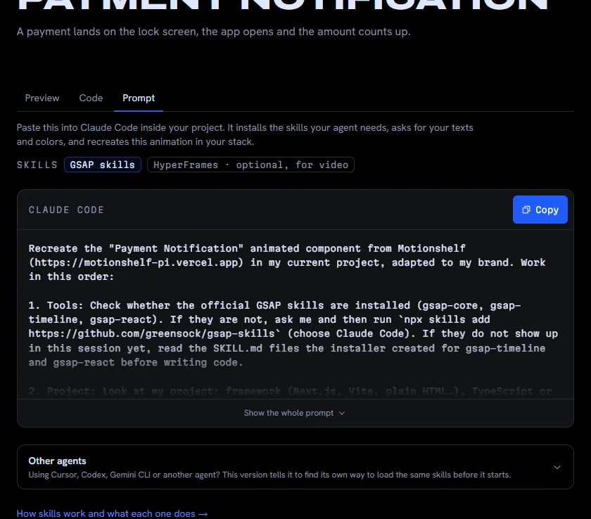

The prompt tells the agent which skill to load, asks for your texts, colors and language before it writes code, describes the animation step by step with its timings, lists the rules that keep a loop clean, and asks it to check the result. A second version, **Other agents**, tells Cursor, Codex, Gemini CLI and others how to load the same knowledge.

| Skill | What it's for | Install in Claude Code |
|---|---|---|
| [GSAP skills](https://github.com/greensock/gsap-skills) (GreenSock, MIT) | Animation on the page: timelines, `useGSAP` | `npx skills add https://github.com/greensock/gsap-skills` |
| [anatomy](https://github.com/wheresryan22/anatomy) (MIT) | Isometric figures (the Anatomy components) | `npx skills add wheresryan22/anatomy -g -a claude-code` |
| [HyperFrames](https://github.com/heygen-com/hyperframes) (HeyGen, Apache-2.0) | Optional: turn the animation into an MP4 | `claude plugin marketplace add heygen-com/hyperframes`<br>`claude plugin install hyperframes@hyperframes` |

More in [Make it with your agent](https://motionshelf-pi.vercel.app/docs/agents).

## How it works

- **One source per component.** `registry/motionshelf/<slug>/<slug>.tsx` is what the site previews, what the Code tab shows and what the registry ships.
- **Catalog.** `lib/catalog.ts` holds names, categories, codes, summaries and props (English and Portuguese) for the sidebar, search, gallery and pages.
- **Prompts.** `lib/prompts.ts` keeps one recipe per component (what it looks like, the animation beat by beat, what to ask the user) and builds the Claude Code and Other agents prompts in both languages.
- **Anatomy figures.** The static drawing is generated with the anatomy skill into a `*-figure.ts` file (SVG, CSS and the model's constants); the React component only moves the live parts on top of it.
- **Registry build.** `pnpm build` runs `shadcn build` first and writes `public/r/<slug>.json`.

## Tech stack

Next.js 15 (App Router) · React 19 · TypeScript · Tailwind CSS v4 · GSAP 3 with `@gsap/react` · next-intl (`/en`, `/pt`) · shiki · cmdk (⌘K search) · three.js with React Three Fiber (the 3D devices on the home page) · Phosphor icons · deployed on Vercel.

## Development

```bash
pnpm install
pnpm dev          # http://localhost:3000
pnpm build        # builds the registry, then the site
```

```text
app/[locale]/                 pages: home, /components, /components/[slug], /docs
components/site/              site UI: tabs, gallery, showcase, prompt panel, devices
registry/motionshelf/<slug>/  the components, as shipped by the registry
lib/catalog.ts                component metadata (en/pt)
lib/prompts.ts                Prompt tab recipes and builder
messages/                     interface texts (en/pt)
```

## Credits

- Hero background: **Faulty Terminal** from [React Bits](https://reactbits.dev) (MIT + Commons Clause), used as site decoration only. It is not part of the registry.
- Isometric figures drawn with the [anatomy](https://github.com/wheresryan22/anatomy) skill kit (MIT, © 2026 Ryan).
- Page Speed Gauge bounce curve: Google, Think with Google (2017).
- Animation by [GSAP](https://gsap.com).

## License

The components and this site's code are released under the [MIT license](LICENSE).
